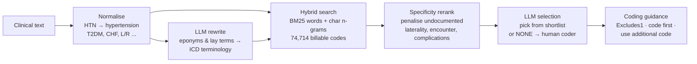
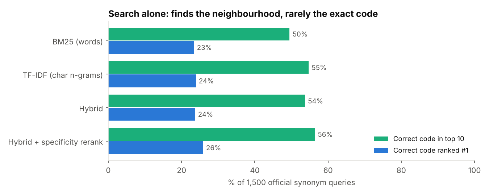
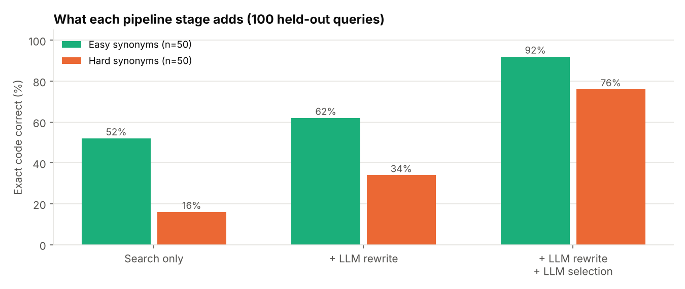

# AI Medical Coding Assistant (ICD-10-CM)

Every diagnosis in a US medical record has to be translated into an **ICD-10-CM code** before a claim can be billed. There are **74,714 billable codes**, and coding errors are a major cause of denied claims. This project builds an assistant that suggests codes from clinical text, explains the coding rules that apply, and knows when to hand a case to a human coder.

```
$ python code_note.py "T2DM with diabetic CKD stage 3a; acute on chronic systolic CHF;
                       type 1 diabetes mellitus without complications; Wolff-Parkinson-White syndrome; pt c/o L knee pain"

▸ T2DM with diabetic CKD stage 3a
   1. E11.22    Type 2 diabetes mellitus with diabetic chronic kidney disease
      ⚑ Use additional code: code to identify stage of chronic kidney disease (N18.1-N18.6)
▸ acute on chronic systolic CHF
   1. I50.23    Acute on chronic systolic (congestive) heart failure
▸ type 1 diabetes mellitus without complications
   1. E10.9     Type 1 diabetes mellitus without complications
   2. E10.638   Type 1 diabetes mellitus with other oral complications   (undocumented detail: with complication)
▸ Wolff-Parkinson-White syndrome
   1. I45.6     Pre-excitation syndrome
▸ pt c/o L knee pain
   1. M25.562   Pain in left knee

⚠ Excludes1: E11.22 and E10.9 should not be coded together (type 1 diabetes mellitus (E10.-))
```

It expands abbreviations (T2DM, CHF, L), maps an eponym to its official name (WPW → pre-excitation syndrome), prefers the code that matches the documented level of detail, surfaces the "use additional code" instruction, and catches an **Excludes1 conflict**: type 1 and type 2 diabetes can't be coded together.

## How it works



Design choices:
- **The LLM never invents codes.** The rewrite step outputs search words only. The selection step must choose from the retrieved shortlist, and any code outside it is rejected. Every suggested code is real and billable.
- **"NONE" is a valid answer.** If nothing in the shortlist fits, the case goes to a human coder instead of being forced into a wrong code.
- **Coding rules come from the official code set**: Excludes1, "code first" and "use additional code" notes, inherited from parent categories as the guidelines require.

## Evaluation

**Benchmark built from official data, not hand-labelled.** ICD-10-CM lists *inclusion terms* under many codes: alternative names clinicians use, such as "Stein-Leventhal syndrome" under E28.2 Polycystic ovarian syndrome. Each inclusion term becomes a query, and its code is the answer. The search index used for testing contains **descriptions only**, so every query is wording the system has never seen. Queries are tagged *hard* when they share less than half their words with the code's description.

### Part A: search alone (1,500 queries)



| System | Top-1 | Top-10 | Right category, top-1 | Hard: top-10 |
|---|---|---|---|---|
| BM25 (words) | 23% | 50% | 51% | 19% |
| TF-IDF (character n-grams) | 24% | 55% | 53% | 28% |
| Hybrid (fusion) | 24% | 54% | 52% | 23% |
| **Hybrid + specificity rerank** | **26%** | **56%** | **54%** | 25% |

Search alone finds the right neighbourhood but rarely the exact code. It's hopeless on synonyms that need medical knowledge: "foot ringworm" → tinea pedis, "hyaline membrane disease" → newborn respiratory distress syndrome. Text matching can't make those connections.

### Part B: the full pipeline (100 held-out queries, 50 hard / 50 easy)



| Stage | Exact code correct | Correct code in the 15-code shortlist |
|---|---|---|
| Search only | 34% | 56% |
| + LLM rewrite | 48% | **86%** |
| **+ LLM rewrite + LLM selection** | **84%** | — |

- **Hard synonyms: 16% → 76%.** Easy synonyms: 52% → 92%.
- The system auto-coded **91%** of queries with **92% precision**, and the right 3-character category 97% of the time.
- **All 9 cases it routed to a human were genuinely unanswerable from its shortlist**: the right code wasn't there. It knew when it didn't know.
- Of the 7 wrong auto-codes, 5 were search misses (the right code never reached the shortlist) and only 2 were selection mistakes. **Improving search is the next lever**, for example with medical embeddings or a second rewrite.

Every query and answer is in [`results/pipeline_per_query.csv`](results/pipeline_per_query.csv).

### How the LLM steps were run (read this)

No Anthropic API key was available in the build environment, so both LLM steps in Part B were performed **by Claude in an interactive session**, using the same instructions as the prompts in [`icd10/llm.py`](icd10/llm.py). To keep that honest:

- The 100 queries were sampled from benchmark rows that were never used during development (rows 400+).
- Claude saw only the queries, never the answers. The rewrites were **committed to git before retrieval ran**, and the selections were committed (with the exact shortlists shown) **before any scoring**. The commit history shows this order.
- With an API key, the same pipeline runs automatically: `python code_note.py --llm "..."`. Re-running the benchmark through the API is the natural next step.

## Run it

```bash
pip install -r requirements.txt
python code_note.py "HTN; T2DM with diabetic CKD stage 3a"        # search + rules, no API key needed
export ANTHROPIC_API_KEY=sk-ant-...
python code_note.py --llm "Wolff-Parkinson-White syndrome"         # full pipeline with Claude
python eval/build_synonym_benchmark.py                             # rebuild benchmark
python eval/run_eval.py                                            # reproduce all numbers (~7 min)
pytest                                                             # 12 tests
```

## Data

- **ICD-10-CM, April 1, 2026 release** (CMS/CDC), via the [`simple-icd-10-cm`](https://github.com/StefanoTrv/simple_icd_10_CM) package, which bundles the official tabular XML: 74,714 billable codes with inclusion terms and instructional notes. ICD-10-CM is in the public domain.

## Limitations

- The benchmark measures **terminology mapping** (one concept → one code), not full-chart coding. Real notes add context, negation ("no evidence of pneumonia"), sequencing and combination codes.
- Not a substitute for a certified coder. Suggestions are meant to be reviewed.
- Search is purely lexical. Medical embeddings (e.g. SapBERT) would likely lift shortlist recall.

## Project structure

```
├── icd10/
│   ├── codeset.py    # billable codes + Excludes1 / code first / use additional notes
│   ├── normalize.py  # clinical abbreviations
│   ├── retriever.py  # BM25, char n-gram TF-IDF, hybrid fusion
│   ├── rerank.py     # specificity-aware reranking
│   ├── llm.py        # Claude rewrite + constrained selection
│   └── pipeline.py   # end-to-end coder, problem-list coding, conflict checks
├── code_note.py      # CLI
├── eval/             # benchmark builder, frozen LLM answers, scorer
├── results/
├── images/
└── tests/
```

## Tools

Python · Anthropic Claude API · rank-bm25 · scikit-learn · pandas · Matplotlib · pytest · ICD-10-CM
